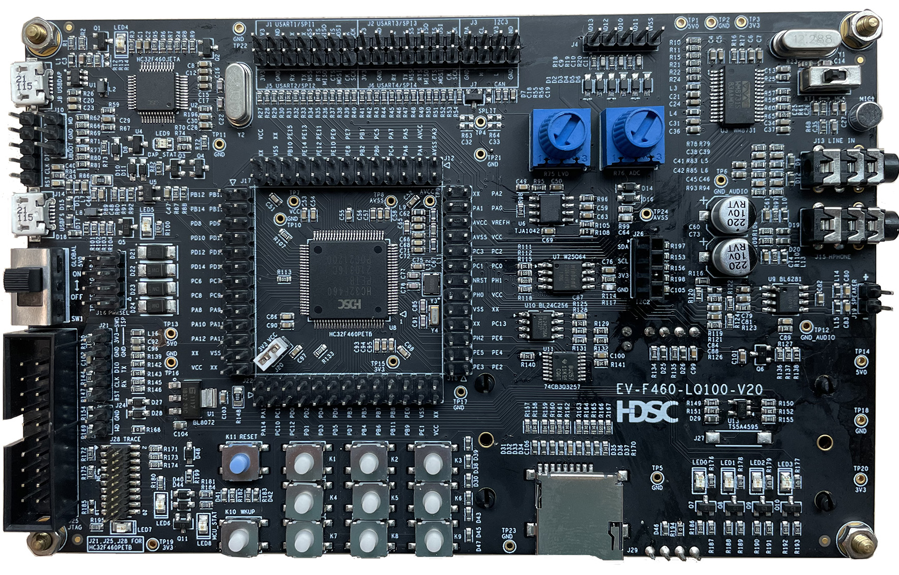

# XHSC EV_F460_LQ100_V2 开发板 BSP 说明

## 简介

本文档为小华半导体为 EV_F460_LQ100_V2 开发板提供的 BSP (板级支持包) 说明。

主要内容如下：

- 开发板资源介绍
- BSP 快速上手
- 进阶使用方法

通过阅读快速上手章节开发者可以快速地上手该 BSP，将 RT-Thread 运行在开发板上。在进阶使用指南章节，将会介绍更多高级功能，帮助开发者利用 RT-Thread 驱动更多板载资源。

## 开发板介绍

EV_F460_LQ100_V2 是 XHSC 官方推出的开发板，搭载 HC32F460PETB 芯片，基于 ARM Cortex-M4 内核，最高主频 200 MHz，具有丰富的板载资源，可以充分发挥 HC32F460PETB 的芯片性能。

开发板外观如下图所示：

 

EV_F460_LQ100_V2 开发板常用 **板载资源** 如下：

- MCU: HC32F460PETB，主频200MHz，512KB FLASH，192KB RAM
- 常用外设
  - LED: 4 个，User LED(LED0，LED1，LED2，LED3)。
  - 按键: 11 个，矩阵键盘(K1~K9), WAKEUP(K10), RESET(K11)
- 常用接口: USB转串口、SD卡接口、USB FS、3.5mm耳机接口、Line in接口、喇叭接口
- 调试接口: 板载DAP调试器、标准JTAG/SWD

开发板更多详细信息请参考小华半导体半导体[EV_F460_LQ100_V2](http://www.xhsc.com.cn)

## 外设支持

本 BSP 目前对外设的支持情况如下：

| **板载外设**  | **支持情况** |               **备注**                |
| :------------ | :-----------: | :-----------------------------------: |
| USB 转串口    |      支持     |          使用 UART4                  |
| LED           |     支持     |           LED                   |
| **片上外设**  | **支持情况** |               **备注**                |
| :------------ | :-----------: | :-----------------------------------: |
| ADC           |     支持     | ADC1: CH10, CH11, CH12,<br>ADC2: CH7 |
| CAN           |     支持     |              CAN1                      |
| GPIO          |     支持     | PA0, PA1... PH2 ---> PIN: 0, 1...82 |
| I2C           |     支持     | 软件 |
| UART          |     支持     |              UART1~4                 |


## 使用说明

使用说明分为如下两个章节：

- 快速上手

    本章节是为刚接触 RT-Thread 的新手准备的使用说明，遵循简单的步骤即可将 RT-Thread 操作系统运行在该开发板上，看到实验效果 。

- 进阶使用

    本章节是为需要在 RT-Thread 操作系统上使用更多开发板资源的开发者准备的。通过使用 ENV 工具对 BSP 进行配置，可以开启更多板载资源，实现更多高级功能。


### 快速上手

本 BSP 为开发者提供 MDK5 和 IAR 工程，并且支持 GCC 开发环境。下面以 MDK5 开发环境为例，介绍如何将系统运行起来。

#### 硬件连接

使用Type-A to MircoUSB线连接开发板和PC供电。

#### 编译下载

双击 project.uvprojx 文件，打开 MDK5 工程，编译并下载程序到开发板。

> 工程默认配置使用板载 DAP 下载程序，点击下载按钮即可下载程序到开发板。

#### 运行结果

下载程序成功之后，系统会自动运行，观察开发板上LED的运行效果，绿色LED1会周期性闪烁。

USB虚拟COM端口默认连接串口4，在终端工具里打开相应的串口，复位设备后，可以看到 RT-Thread 的输出信息:

```
 \ | /
- RT -     Thread Operating System
 / | \     4.1.1 build May 25 2022 08:55:55
 2006 - 2022 Copyright by RT-Thread team
msh >
```

### 进阶使用

此 BSP 默认只开启了 GPIO 和 串口 4 的功能，更多高级功能需要利用 env 工具对 BSP 进行配置，步骤如下：

1. 在 bsp 下打开 env 工具。

2. 输入`menuconfig`命令配置工程，配置好之后保存退出。

3. 输入`pkgs --update`命令更新软件包。

4. 输入`scons --target=mdk5/iar` 命令重新生成工程。

## 注意事项

## 联系人信息

维护人:

-  [小华半导体MCU](http://www.xhsc.com.cn)，邮箱：<mcu_eco@xhsc.com.cn>


# 卸粮筒项目方案设计
## 软件架构设计
┌─────────────────────────────────────────────────────────────────┐
│                    空闲线程 (IDLE Hook)                          │
│  每次进入空闲线程时执行 wdt_feed()，确保系统未彻底死锁              │
└─────────────────────────────────────────────────────────────────┘
                               ↑
                          喂狗保证
                               │
┌─────────────────────────────────────────────────────────────────┐
│                  监控线程 (Monitor Thread)                       │
│  1. 周期性检查各关键线程的心跳变量                                 │
│  2. 若某线程超时未更新心跳 → 记录故障码 → 主动复位                  │
└─────────────────────────────────────────────────────────────────┘
         │                          │                          │
      心跳检查                    心跳检查                    心跳检查
         ↓                          ↓                          ↓
┌───────────────┐      ┌───────────────┐      ┌───────────────┐
│ 电机控制线程   │      │ 传感器采集线程 │      │ CAN收发线程   │
│ 每个周期更新   │      │ 每个周期更新   │      │ 每个周期更新   │
│ heart_beat_1  │      │ heart_beat_2  │      │ heart_beat_3  │
└───────────────┘      └───────────────┘      └───────────────┘


无刷电机控制器 - 多状态机协作架构（方案设计文档）
版本: v0.2 (初稿)
日期: 2026-08-18
状态: 方案设计完成，状态机引擎已实现
项目: 无刷电机控制器（单轴云台/机械臂类）

一、 系统概述
基于 RT-Thread 实时操作系统，构建多状态机协作架构的无刷电机控制器。系统包含一个旋转轴（支持水平旋转和俯仰角动作），采用 BLDC 无刷电机驱动，支持 SVPWM/FOC 控制。

1.1 核心设计原则
序号	原则	说明
1	模块与线程绑定	每个功能模块拥有独立线程，状态机在该线程中运行
2	状态机驱动行为	模块的业务行为由状态机状态驱动，而非条件判断堆砌
3	异步事件驱动通信	模块间通过异步事件通信（消息队列 + 事件集），避免递归风险
4	统一引擎管理	所有状态机由通用引擎管理，支持多实例、内存池、句柄校验
5	分层初始化	按"驱动层 → 独立状态机 → 依赖状态机 → 协调器"顺序初始化
6	错误自下而上传播	子模块故障通过事件向依赖方传播，最终汇聚到系统状态机
二、 状态机清单
序号	状态机名称	所属线程	初始状态	依赖关系
1	系统状态机	系统线程	STATE_INITIALIZING	无（最顶层）
2	轴状态机	轴控制线程	STATE_IDLE	水平角度SM、垂直角度SM、电机SM
3	电机状态机	轴控制线程（合并）	STATE_STOP	电源SM
4	水平角度状态机	传感器线程	STATE_UNINIT	SPI驱动
5	垂直角度状态机	传感器线程（合并）	STATE_UNINIT	ADC驱动
6	CAN状态机	CAN线程	STATE_OFFLINE	CAN驱动
7	电源状态机	电源监控线程	STATE_CHECKING	ADC驱动
8	故障状态机	故障诊断线程	STATE_IDLE	无（被动响应）
三、 线程映射关系
线程名称	优先级	栈大小	包含的状态机	周期
系统线程	最高(1)	2048	系统SM	事件驱动
轴控制线程	高(2)	4096	轴SM + 电机SM	1ms（控制周期）
传感器线程	中高(3)	2048	水平角度SM + 垂直角度SM	1ms（采集周期）
CAN线程	中(4)	2048	CAN SM	事件驱动 + 100ms轮询
电源监控线程	低(5)	1024	电源SM	50ms
故障诊断线程	低(6)	1024	故障SM	50ms
四、 跨线程通信设计
4.1 通信方式
通信场景	发送方	接收方	通信方式	事件/数据
控制命令	CAN线程	轴控制线程	消息队列	AxisEvent_t
系统状态变更	系统线程	所有线程	消息队列	SystemEvent_t
紧急停机	任何线程	所有线程	事件集	EVT_FLAG_EMERGENCY
故障触发	故障线程	系统/轴线程	事件集	EVT_FLAG_FAULT
角度数据就绪	传感器线程	轴控制线程	消息队列	FusionResult_t
电机状态反馈	轴控制线程	CAN线程	消息队列	MotorStatus_t
4.2 关键设计决策
事件发送方式：所有跨模块事件通过 rt_mq_send() 异步发送，不直接调用其他线程的 SM_SendEvent()。这样：

避免了跨线程递归调用

各线程独立运行，互不阻塞

天然支持事件缓存和防丢

紧急事件通道：使用 RT-Thread 事件集（Event）处理紧急事件，实现快速响应。

4.3 事件ID分配规范
为避免不同模块的事件值冲突，采用事件ID分段：

事件段	起始值	所属模块
EVENT_BASE_SYSTEM	0x0000	系统事件
EVENT_BASE_AXIS	0x1000	轴事件
EVENT_BASE_MOTOR	0x2000	电机事件
EVENT_BASE_ANGLE_H	0x3000	水平角度事件
EVENT_BASE_ANGLE_V	0x4000	垂直角度事件
EVENT_BASE_CAN	0x5000	CAN事件
EVENT_BASE_POWER	0x6000	电源事件
EVENT_BASE_FAULT	0x7000	故障事件
五、 初始化顺序
Phase 1: 硬件驱动初始化
SPI → ADC → PWM → CAN → Flash → WDT

Phase 2: 状态机引擎初始化
SM_Engine_Init() → 内存池就绪 → TLS创建

Phase 3: 独立状态机创建（不依赖其他状态机）
系统SM → 故障SM → CAN SM → 电源SM

Phase 4: 依赖状态机创建
水平角度SM → 垂直角度SM → 电机SM → 轴SM

Phase 5: 线程启动
所有线程创建并启动

Phase 6: 系统启动触发
发送 EVT_SYSTEM_START → 系统SM进入NORMAL

六、 状态机引擎设计
6.1 核心特性
特性	说明
静态内存池	编译期确定最大实例数（默认16），无动态内存分配
多实例支持	每个状态机独立运行，通过句柄访问
线程安全	每个实例独立互斥锁，支持跨线程调用
句柄校验	魔数 + 版本号双重校验，防止野指针
STATE_ANY 通配符	简化跳转表，支持"任意状态"匹配
Enter/Exit 回调	进入/退出状态时执行业务逻辑，带上下文指针
状态变更通知	状态切换后触发回调，便于日志和跨状态机协调
事件未处理通知	收到未定义事件时触发回调
双重递归保护	线程级 + 实例级，最大深度5
调试支持	状态名称映射、实例遍历、状态转储
6.2 递归保护策略
保护层级	存储位置	作用
线程级	RT-Thread TLS	防止同一线程内递归调用导致栈溢出
实例级	内存池槽位	防止同一状态机实例被递归重入
深度阈值：默认5（编译期宏 SM_CONFIG_MAX_DEPTH 可配置，运行时 SM_SetMaxDepth() 可调整）

6.3 核心数据结构
c
/* 状态跳转表项 */
typedef struct {
    State_t cur_state;      /* 当前状态 */
    Event_t event;          /* 触发事件 */
    State_t target_state;   /* 目标状态 */
} StateJumpTable_t;

/* 状态函数表项 */
typedef struct {
    State_t state;          /* 状态值 */
    StateFunc_t enter;      /* 进入状态时执行 */
    StateFunc_t exit;       /* 退出状态时执行 */
    void* context;          /* 状态专用上下文 */
} StateFuncTable_t;

/* 状态机配置 */
typedef struct {
    const StateJumpTable_t* jump_table;
    uint16_t jump_table_size;
    const StateFuncTable_t* func_table;
    uint16_t func_table_size;
    State_t init_state;
    void* context;
    OnStateChanged_t on_state_changed;
    OnUnhandledEvent_t on_unhandled_event;
    OnRecursionOverflow_t on_recursion_overflow;
} SM_Config_t;
6.4 核心API
c
/* 引擎生命周期 */
int SM_Engine_Init(void);
uint8_t SM_Engine_IsReady(void);

/* 实例管理 */
SM_Handle_t SM_Create(const SM_Config_t* config);
int SM_Destroy(SM_Handle_t handle);
int SM_Reset(SM_Handle_t handle);

/* 状态机操作 */
int SM_SendEvent(SM_Handle_t handle, Event_t event);
State_t SM_GetState(SM_Handle_t handle);
State_t SM_GetPreviousState(SM_Handle_t handle);
rt_tick_t SM_GetStateEntryTick(SM_Handle_t handle);
int SM_CheckTimeout(SM_Handle_t handle, rt_tick_t timeout_tick);
void* SM_GetContext(SM_Handle_t handle);
int SM_SetContext(SM_Handle_t handle, void* context);

/* 递归深度查询（调试用） */
uint8_t SM_GetThreadDepth(void);
uint8_t SM_GetInstanceDepth(SM_Handle_t handle);

/* 调试与诊断 */
uint16_t SM_GetInstanceCount(void);
SM_Handle_t SM_GetHandleByIndex(uint16_t index);
const char* SM_GetStateName(SM_Handle_t handle, State_t state);
int SM_SetStateNameMap(SM_Handle_t handle, const char** name_map, uint16_t map_size);
void SM_DumpAll(void);
void SM_DumpInstance(SM_Handle_t handle);

/* 事件广播 */
void SM_BroadcastEvent(Event_t event);
void SM_BroadcastEventMasked(Event_t event, State_t state_mask);
6.5 配置文件位置
文件	说明
state_engine.h	引擎头文件（API定义 + 注释）
state_engine.c	引擎实现文件（完整实现）
6.6 返回值说明
返回值	含义
0	成功，状态已迁移
-1	句柄无效
-2	事件未处理（跳转表中无匹配项）
-3	线程级递归溢出
-4	实例级递归溢出
七、 错误传播路径
7.1 典型场景：电机过流故障
电源SM (过流检测)
→ 状态迁移: CHECKING → FAULT_OVERCURRENT
→ Exit函数发送 EVT_POWER_FAULT (事件集)

系统SM (收到EVT_POWER_FAULT)
→ 状态迁移: NORMAL → DEGRADED
→ Enter函数记录降级，发送 EVT_SYSTEM_DEGRADED

轴SM (收到EVT_SYSTEM_DEGRADED)
→ 状态迁移: POSITION_CTRL → FAULT
→ Exit函数停止运动

电机SM (收到EVT_SYSTEM_DEGRADED)
→ 状态迁移: RUNNING → FAULT
→ Enter函数关闭PWM

CAN SM (收到EVT_SYSTEM_DEGRADED)
→ 状态迁移: ACTIVE → WARNING
→ Enter函数发送故障报文

7.2 错误传播方向
依赖方向：系统SM → 轴SM → (水平角度SM | 垂直角度SM | 电机SM)
错误传播：子模块故障 → 父模块（自下而上传播）

八、 关键设计决策记录
决策点	决策结果	理由
事件同步方式	异步事件队列（rt_mq_send）	消除递归风险，各线程独立运行
递归保护策略	线程级 + 实例级双重保护	兼顾安全性和精确性
深度阈值	默认5（可配置）	覆盖所有预期场景，栈安全
状态机间依赖	必须为DAG（有向无环图）	从设计层面杜绝循环依赖
紧急事件通道	RT-Thread事件集（Event）	快速响应，不经过队列排队
调试策略	状态名称映射 + 统一转储	便于问题定位和系统诊断
引擎存储	静态内存池（无动态分配）	适用于嵌入式RTOS环境
九、 文件目录结构（建议）
text
project/
├── common/
│   ├── state_engine.h          # 状态机引擎头文件
│   ├── state_engine.c          # 状态机引擎实现
│   ├── data_def.h              # 核心数据结构
│   ├── error_code.h            # 错误码定义
│   └── macros.h                # 全局宏定义
│
├── driver/
│   ├── drv_spi_encoder.c/.h    # SPI编码器驱动
│   ├── drv_adc.c/.h            # ADC驱动
│   ├── drv_pwm.c/.h            # PWM驱动
│   ├── drv_can.c/.h            # CAN驱动
│   ├── drv_flash.c/.h          # Flash存储驱动
│   ├── drv_gpio.c/.h           # GPIO驱动
│   └── drv_wdt.c/.h            # 看门狗驱动
│
├── service/
│   ├── angle_fusion.c/.h       # 多圈角度融合算法
│   ├── motor_control.c/.h      # FOC/BLDC控制
│   ├── limit_manager.c/.h      # 软限位与路径规划
│   └── pid_controller.c/.h     # PID控制器
│
├── sm_modules/                  # 各状态机模块
│   ├── sm_system/
│   │   ├── sm_system.h         # 系统状态机API
│   │   ├── sm_system_table.c   # 跳转表
│   │   └── sm_system_funcs.c   # Enter/Exit函数
│   ├── sm_axis/
│   │   ├── sm_axis.h
│   │   ├── sm_axis_table.c
│   │   └── sm_axis_funcs.c
│   ├── sm_motor/
│   │   ├── sm_motor.h
│   │   ├── sm_motor_table.c
│   │   └── sm_motor_funcs.c
│   ├── sm_angle_horiz/
│   │   ├── sm_angle_horiz.h
│   │   ├── sm_angle_horiz_table.c
│   │   └── sm_angle_horiz_funcs.c
│   ├── sm_angle_vert/
│   │   ├── sm_angle_vert.h
│   │   ├── sm_angle_vert_table.c
│   │   └── sm_angle_vert_funcs.c
│   ├── sm_can/
│   │   ├── sm_can.h
│   │   ├── sm_can_table.c
│   │   └── sm_can_funcs.c
│   ├── sm_power/
│   │   ├── sm_power.h
│   │   ├── sm_power_table.c
│   │   └── sm_power_funcs.c
│   └── sm_fault/
│       ├── sm_fault.h
│       ├── sm_fault_table.c
│       └── sm_fault_funcs.c
│
├── app/
│   ├── coordinator.c/.h        # 系统协调器
│   ├── axis_state_machine.c/.h # 轴控状态机（主控逻辑）
│   ├── can_app_protocol.c/.h   # CAN应用协议
│   └── fault_handler.c/.h      # 故障诊断与保护
│
├── monitor/
│   ├── thread_heartbeat.c/.h   # 线程心跳监控
│   └── watchdog_manager.c/.h   # 看门狗管理
│
├── applications/
│   ├── main.c                  # 主入口
│   ├── system_init.c/.h        # 系统初始化
│   └── rtconfig.h              # RT-Thread配置
│
└── design_doc.md               # 本设计文档
十、 下一步工作
序号	任务	优先级	说明
1	定义各状态机的状态/事件枚举	高	8个状态机，每个需定义状态和事件枚举
2	设计各状态机的跳转表	高	状态迁移矩阵设计
3	实现各状态机的 Enter/Exit 函数	高	具体业务逻辑实现
4	设计协调器（Coordinator）	中	跨状态机协调逻辑
5	定义统一事件ID分配表	中	避免跨模块事件冲突
6	单元测试用例设计	低	验证各状态机逻辑
7	状态机引擎压力测试	低	验证递归保护机制
附录A：状态机引擎配置宏
c
/* state_engine.h 编译期配置 */

#define SM_CONFIG_MAX_INSTANCES  16    /* 最大实例数 */
#define SM_CONFIG_MAX_DEPTH      5     /* 最大递归深度 */
#define SM_CONFIG_TLS_ENABLE     1     /* 启用TLS线程级深度追踪 */

/* 可选：运行时配置 */
int SM_SetMaxDepth(uint8_t max_depth);   /* 动态调整深度阈值 */
附录B：递归保护说明
为什么需要双重保护？
保护层级	解决的问题	检测方式
线程级	同一线程内递归调用导致栈溢出	检测当前线程的嵌套深度
实例级	同一状态机实例被递归重入	检测该实例的嵌套深度
深度阈值5的依据
典型嵌入式系统线程栈为 2048~4096 字节

单次 SM_SendEvent + Enter/Exit 回调约 128~256 字节

5层 × 256字节 = 1280字节，留有充足余量

业务层预期最大深度 ≤ 3层，5层提供安全余量

递归溢出处理
当递归深度超限时，引擎会：

返回特定错误码（-3 或 -4）

调用 OnRecursionOverflow_t 回调（如果配置）

打印错误日志

拒绝执行状态迁移，保持状态不变

附录C：版本历史
版本	日期	变更内容
v0.1	2026-08-18	初稿创建
v0.2	2026-08-18	增加状态机引擎完整设计、递归保护机制、文件目录结构